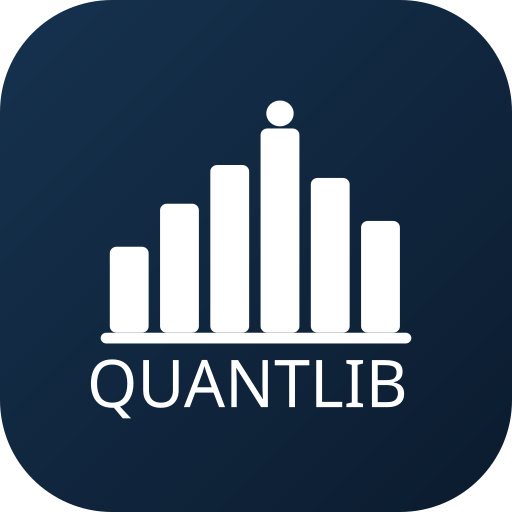

<div align="center">



# QuantLib

**School Library Inventory & Analytics System**

[](https://github.com/alinsamba/quantlib/releases)
[](LICENSE)
[](https://tauri.app)
[](https://react.dev)
[](https://www.rust-lang.org)
[](https://github.com/alinsamba/quantlib/actions)
[](#)

<br/>

> A beautiful, encrypted, offline-first desktop app that replaces spreadsheet chaos with a purpose-built library management system — built for school librarians.

> [!WARNING]
> **QuantLib v2.0 is currently in beta.** Features are mostly stable but you may encounter bugs or rough edges. Please [open an issue](https://github.com/alinsamba/quantlib/issues) if you run into anything unexpected. Back up your database regularly using the built-in backup feature.

<br/>


<br/>

[📦 Download Installer](#-download--install) · [🚀 Getting Started](#-getting-started) · [✨ Features](#-features) · [🔐 Security](#-security--encryption-architecture) · [🛠️ Tech Stack](#%EF%B8%8F-tech-stack)

</div>

---

## 📦 Download & Install

The latest pre-built installers are published on the [**GitHub Releases**](https://github.com/alinsamba/quantlib/releases) page. Pick the installer for your platform:

| Platform | Installer | Notes |
| :--- | :--- | :--- |
| 🪟 **Windows** | `.msi` or `-setup.exe` | Windows 10 / 11 (x64) |
| 🐧 **Linux** | `.deb`, `.rpm`, or `.AppImage` | Ubuntu/Fedora/Any distro |
| 🍎 **macOS** | Universal `.dmg` | Apple Silicon + Intel |

---

## ✨ Features

### 📚 Circulation Desk
The command centre for daily library operations. Issue books to students or staff in seconds with the **Quick Issue** form, track due dates with one-click presets (Today / 3d / 7d / 14d / 30d), monitor overdue notices at a glance, and return or renew books from the **Quick Return & Active Loans** panel.

### 📋 Borrow & Return Log
A full timestamped history of every borrow, return, and renewal action across all subjects. Filter by student, class, or date range, and export to CSV for term-end reporting.

### 👩‍🎓 Students & Staff Directory
Manage your complete roster of borrowers — students and teachers. Add, edit, or remove records; view each person's active loans and borrowing history; and run **end-of-term student promotions** in one click (S1 → S2, S2 → S3, etc.).

### 📦 Inventory Management
Track your full subject-level book stock with the formula:

$$\text{Available} = \text{Opening} + \text{Recovered} - \text{Issued} - \text{Damaged} - \text{Lost}$$

Import bulk stock from Excel (`.xlsx`) or CSV, export reports, and see real-time availability per subject.

### ⚠️ Overdue Books
A dedicated view of every overdue checkout with the number of days past due, borrower details, and accumulated fine amounts. Record fine payments, waive fines, or bulk-action overdue returns with condition tracking.

### 🏅 Clearance
Check if a student or staff member is **clear to leave** (no active loans, no outstanding fines). Generate and print an official **Clearance Slip** per borrower with school branding, stamp area, and date.

### 📊 Dashboard & Analytics
- **Dashboard**: Summary cards for active loans, overdue count, low-stock subjects, and pending incidents, plus an interactive stock distribution pie chart.
- **Analytics**: Deeper visualisations — book condition health trends, depreciation estimates per checkout cycle, circulation frequency, and subject popularity.

### 🚨 Incident Log
Report and track damaged, lost, or recovered books. Each incident automatically adjusts the relevant stock counter and appends an entry to the audit trail.

### 🔎 Stock Audit
Run a **physical reconciliation audit** — scan or enter physical counts shelf-by-shelf, compare against system stock, and complete the audit to lock in discrepancies. All completed audits are stored and browsable.

### ⚙️ Settings
Customise school branding (name, motto, logo), configure **borrowing rules** per grade/role (maximum books, loan duration, fine per day), manage encrypted **database backups** (manual or automated schedule), set up **LAN sync** for peer-to-peer data sharing across library computers, and export the full database as CSV.

---

## 🔐 Security & Encryption Architecture

QuantLib operates on an **offline vault** security model — data never leaves your device unless you explicitly export it.

```
┌─────────────────────────────────────────────────────────────┐
│                      USER PASSWORD                          │
│                           │                                 │
│              PBKDF2-HMAC-SHA256 (600,000 iters)             │
│                           │                                 │
│                    Derived Key (256-bit)                     │
│                           │                                 │
│         ┌─────────────────┴──────────────────┐              │
│         ▼                                    ▼              │
│   AES-256-GCM encrypts             AES-256-GCM encrypts     │
│   Master Key                       Master Key               │
│   (password wrap)                  (recovery key wrap)      │
│         └─────────────────┬──────────────────┘              │
│                           ▼                                 │
│               Encrypted SQLite database                      │
│               (AES-256-GCM, 12-byte IVs)                    │
│                           │                                 │
│         Decrypted to temp file only during session          │
│         Zero-wiped + deleted on lock/close (fsync)          │
└─────────────────────────────────────────────────────────────┘
```

| Layer | Detail |
| :--- | :--- |
| 🔑 **Key Derivation** | PBKDF2-HMAC-SHA256, 600,000 iterations, 16-byte random salt |
| 🔒 **Encryption** | AES-256-GCM with 12-byte distinct IVs and 16-byte authentication tags |
| 🛡️ **Dual Key Wrapping** | Master Key wrapped under both password AND a 16-char emergency Recovery Key |
| 🧹 **Secure Wipe** | Temp DB overwritten with zero-bytes (`fsync`) and deleted on every lock/close |
| 📴 **Offline First** | Zero network calls; LAN sync is opt-in and passcode-protected |

---

## 🛠️ Tech Stack

<div align="center">

| Layer | Technology |
| :--- | :--- |
| 🖥️ Desktop Shell | [Tauri v2](https://tauri.app/) — Rust core + IPC command system + frameless window |
| ⚛️ UI | [React 19](https://react.dev/) + [TypeScript](https://www.typescriptlang.org/) + [Vite 8](https://vitejs.dev/) |
| 🎨 Styling | [Tailwind CSS v4](https://tailwindcss.com/) · [Lucide React](https://lucide.dev/) · Custom *Chalk & Ledger* theme |
| 📈 Charts | [Recharts](https://recharts.org/) |
| 📊 Spreadsheets | [SheetJS (`xlsx`)](https://sheetjs.com/) — Excel import/export |
| 🗄️ Database | [SQLite](https://www.sqlite.org/) via [`rusqlite`](https://github.com/rusqlite/rusqlite) (bundled, WAL mode) |
| 🔐 Crypto | Pure Rust — `aes-gcm` · `pbkdf2` · `hmac` · `sha2` · `rand` |
| 🌐 LAN Sync | Pure Rust TCP (`std::net`) with `X-QuantLib-Passcode` header auth |
| 🧪 Testing | [Vitest](https://vitest.dev/) (frontend) · `cargo test` (Rust) · [Oxlint](https://oxc.rs/) |
| 📦 Packaging | [Tauri CLI](https://tauri.app/reference/cli/) — `.msi`, `.exe`, `.deb`, `.rpm`, `.AppImage`, `.dmg` |

</div>

---

## 📁 Project Structure

```text
quantlib/
├── .github/workflows/
│   ├── node.js.yml          # CI — lint, test, build (Node 20 & 22 + Rust)
│   └── release.yml          # Release — cross-platform Tauri installers
├── src-tauri/               # Tauri v2 Rust Core
│   ├── src/
│   │   ├── main.rs          # Binary entry point
│   │   ├── lib.rs           # Tauri builder, state & command registration
│   │   ├── commands.rs      # Tauri IPC command handlers (~50 commands)
│   │   ├── db.rs            # SQLite schema, queries & CRUD
│   │   ├── crypto.rs        # AES-256-GCM vault & PBKDF2 manager
│   │   ├── models.rs        # Rust domain structs & Serde models
│   │   └── services.rs      # Backup scheduler & LAN sync TCP server
│   ├── Cargo.toml           # Rust manifest (v2.0.0)
│   └── tauri.conf.json      # Tauri app config (v2.0.0)
├── src/
│   ├── components/          # TitleBar, Modals, Cards, Buttons, Forms
│   ├── hooks/               # ThemeContext, ToastContext, useAsync
│   ├── lib/                 # ipc-client.ts, types.ts, utils.ts, exportUtils.ts
│   ├── pages/               # CirculationDesk, CirculationLog, Students,
│   │                        # Inventory, Overdue, Clearance, Dashboard,
│   │                        # Incidents, StockAudit, Analytics, Settings, Login
│   ├── styles/              # theme-chalk.css (Chalk & Ledger theme)
│   ├── App.tsx              # Layout shell & auth gate
│   └── routes.tsx           # Lazy-loaded page exports
├── docs/
│   └── screenshot.png       # App screenshot (Circulation Desk)
├── public/                  # Static assets & icons
├── package.json             # Node manifest & scripts (v2.0.0)
└── LICENSE                  # MIT License
```

---

## 🚀 Getting Started

### Prerequisites

| Requirement | Version |
| :--- | :--- |
| [Bun](https://bun.sh) | v1.0+ (or Node.js v18+) |
| [Rust](https://rustup.rs/) | stable (via `rustup`) |
| Tauri v2 system deps | [See Tauri prerequisites](https://tauri.app/start/prerequisites/) |

### Installation

```bash
# 1 — Clone the repository
git clone https://github.com/alinsamba/quantlib.git
cd quantlib

# 2 — Install frontend dependencies
bun install          # or: npm install

# 3 — Run in development mode (Vite + Tauri desktop)
bun run dev          # or: npm run dev
```

> **First launch**: QuantLib will prompt you to create a **Master Password** and show you a one-time **Recovery Key** — save it somewhere safe.

---

## 💻 Development

### Run the Vite dev server standalone (browser preview)

```bash
bun run dev:vite
```

### Run all tests

```bash
# Frontend (Vitest)
bun run test

# Rust backend
cargo test --manifest-path src-tauri/Cargo.toml

# Lint
bun run lint
```

### Package for production

```bash
bun run tauri:build
```

Installers output to `src-tauri/target/release/bundle/`.

---

## 📜 Available Scripts

| Command | Description |
| :--- | :--- |
| `bun run dev` | Runs full Tauri desktop app in dev mode |
| `bun run dev:vite` | Starts the Vite frontend server standalone |
| `bun run build` | Type-checks & builds Vite frontend distribution |
| `bun run tauri:build` | Compiles & packages production Tauri app |
| `bun run test` | Runs frontend unit tests (Vitest) |
| `bun run lint` | Runs Oxlint on all frontend source files |
| `bun run preview` | Previews the built Vite frontend |
| `bun run generate-icon` | Regenerates the app PNG icon |

---

## 📄 License & Credits

Licensed under the [MIT License](LICENSE).

Developed for **Mentor High School Library Book Tracking**, Uganda. Replaces legacy Excel-based management workflows.

---

<div align="center">

Made with ❤️ for school librarians

⭐ Star this repo if it helps your school!

</div>
