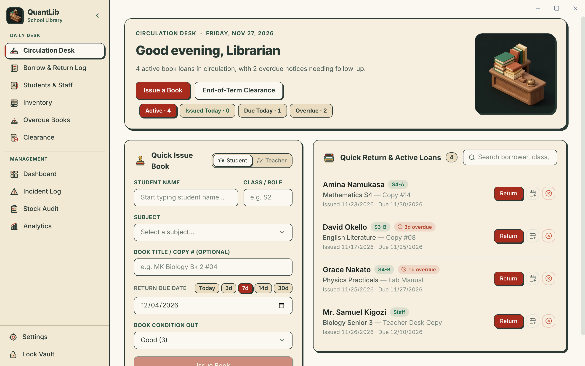

# QuantLib v2.0

**Version:** `2.0.0`

**QuantLib** is an offline-first School Library Inventory & Analytics desktop application built with Tauri v2, React, TypeScript, and Rust. It modernizes spreadsheet-based book tracking into a secure, encrypted desktop system tailored for school librarians, featuring circulation management, student/staff directories, incident logging, stock audits, clearance tracking, and analytics.



---

## Key Features

- **Zero-Trust Encrypted Storage**: Offline SQLite database encrypted at rest using AES-256-GCM with PBKDF2-HMAC-SHA256 key derivation (600,000 iterations), emergency recovery key support, and secure memory/temp-file wipe on shutdown.
- **Circulation Desk & Borrow/Return Log**: Issue, renew, and return books with configurable borrowing rules, custom due dates, condition tracking, and a dedicated Borrow & Return Log with CSV export.
- **Students & Staff Directory**: Manage borrower records, track active loans, and perform end-of-term/year student promotions.
- **Inventory & Stock Tracking**: Real-time stock calculation per subject (`Available = Opening + Recovered - Issued - Damaged - Lost`) with Excel (`.xlsx`) and CSV import/export.
- **Overdue Management & Clearance**: Monitor overdue books, record or waive fines, check borrower clearance status, and generate clearance slips.
- **Incident Logging & Stock Audits**: Log damaged, lost, or recovered books with automated counter updates, run physical stock audits, and maintain an immutable audit trail.
- **Dashboard & Analytics**: Interactive Recharts visualizations for stock distribution, book condition health, depreciation, circulation insights, and low-stock warnings.
- **Backups, LAN Sync & School Branding**: Automated/manual encrypted database backups, full CSV database export, peer-to-peer LAN sync over TCP, custom school branding, and the **Chalk & Ledger** theme with a custom frameless window.

---

## Tech Stack

- **Desktop Framework**: [Tauri v2](https://tauri.app/) (Rust Core + IPC Command System)
- **UI Framework**: [React 19](https://react.dev/) + [TypeScript](https://www.typescriptlang.org/) + [Vite 8](https://vitejs.dev/)
- **Styling**: [Tailwind CSS v4](https://tailwindcss.com/) + [Lucide React](https://lucide.dev/)
- **Charts & Spreadsheets**: [Recharts](https://recharts.org/) + [SheetJS (`xlsx`)](https://sheetjs.com/)
- **Database**: [SQLite](https://www.sqlite.org/) via [`rusqlite`](https://github.com/rusqlite/rusqlite) (bundled)
- **Security & Crypto**: Pure Rust cryptography (`aes-gcm`, `pbkdf2`, `hmac`, `sha2`, `rand`)
- **LAN Sync**: Pure Rust TCP server/client (`std::net`) with passcode header authentication
- **Testing & Linting**: [Vitest](https://vitest.dev/) (frontend), `cargo test` (Rust backend), and [Oxlint](https://oxc.rs/)

---

## Security & Encryption Architecture

QuantLib operates on an offline vault security model:
1. **Master Key Derivation**: User passwords derive cryptographic keys using **PBKDF2-HMAC-SHA256** with **600,000 iterations** and a 16-byte random salt.
2. **Dual-Key Wrapping**: A 256-bit random Master Key is encrypted using **AES-256-GCM** under both the Master Password and an emergency **Recovery Key**.
3. **Database Encryption**: The SQLite database file is encrypted at rest using AES-256-GCM with 12-byte distinct IVs and 16-byte authentication tags.
4. **Secure In-Memory Session**: During execution, the decrypted working database is maintained in local application data storage and re-encrypted on write.
5. **Secure Memory Wipe**: Upon locking or closing the app, the temporary database file is overwritten with zero-bytes (`fsync`) and deleted, and key buffers in memory are wiped.

---

## Project Structure

```text
quantlib/
├── src-tauri/                  # Tauri v2 Rust Core
│   ├── src/
│   │   ├── main.rs             # Application binary entry point
│   │   ├── lib.rs              # Tauri builder, state setup & command registration
│   │   ├── commands.rs         # Tauri IPC command handlers
│   │   ├── db.rs               # SQLite schema, queries & CRUD logic
│   │   ├── crypto.rs           # AES-256-GCM vault encryption & PBKDF2 manager
│   │   ├── models.rs           # Rust domain structs & Serde models
│   │   └── services.rs         # Analytics, backup scheduler & LAN sync services
│   ├── Cargo.toml              # Rust crate manifest & dependencies (v2.0.0)
│   └── tauri.conf.json         # Tauri application configuration (v2.0.0)
├── src/
│   ├── components/             # Reusable UI components (TitleBar, Modals, Cards)
│   ├── hooks/                  # React context providers & hooks (Theme, Toast, useAsync)
│   ├── lib/                    # Utilities, types, export helpers & Tauri IPC client
│   ├── pages/                  # Views (CirculationDesk, CirculationLog, Students,
│   │                           # Inventory, Overdue, Clearance, Dashboard,
│   │                           # Incidents, StockAudit, Analytics, Settings, Login)
│   ├── styles/                 # Chalk & Ledger theme styles (`theme-chalk.css`)
│   ├── App.tsx                 # Main layout & navigation shell
│   ├── routes.tsx              # Lazy-loaded route exports
│   └── index.css               # Tailwind CSS entry file
├── package.json                # Node/Bun manifest & scripts (v2.0.0)
└── vite.config.ts              # Vite frontend configuration
```

---

## Getting Started

### Prerequisites
- **Node.js** (v18+) or **Bun**
- **Rust** toolchain (`rustc` & `cargo`) and Tauri v2 system prerequisites

### Installation

1. Navigate to the repository directory:
   ```bash
   cd quantlib
   ```
2. Install dependencies:
   ```bash
   npm install
   # or: bun install
   ```

---

## Development & Building

### Running the App Locally

Start the Tauri desktop application in development mode (automatically starts the Vite frontend dev server):
```bash
npm run dev
# or: bun run dev
```

To run the Vite web dev server independently (without the Tauri desktop shell):
```bash
npm run dev:vite
```

### Running Tests & Linting

Run frontend unit tests with Vitest:
```bash
npm run test
```

Run Rust backend tests:
```bash
cargo test --manifest-path src-tauri/Cargo.toml
```

Run Oxlint:
```bash
npm run lint
```

### Packaging for Production

Build the production desktop binary and installers:
```bash
npm run tauri:build
```
The packaged app installers and standalone executables are output to `src-tauri/target/release/`.

---

## Available Scripts

| Command | Description |
| :--- | :--- |
| `npm run dev` | Runs Tauri desktop app in development mode (`tauri dev`) |
| `npm run dev:vite` | Starts the Vite frontend development server standalone |
| `npm run build` | Type-checks with TypeScript and builds Vite frontend distribution |
| `npm run tauri:dev` | Alias for `tauri dev` |
| `npm run tauri:build` | Compiles and packages the production Tauri desktop app |
| `npm run test` | Runs frontend unit tests using Vitest |
| `npm run lint` | Runs Oxlint to check frontend code quality |
| `npm run preview` | Previews the built Vite frontend |
| `npm run generate-icon` | Generates application PNG icon |

---

## License & Credits

Licensed under the [MIT License](LICENSE).

Developed for **Mentor High School Library Book Tracking**. Replaces legacy Excel-based management workflows.
